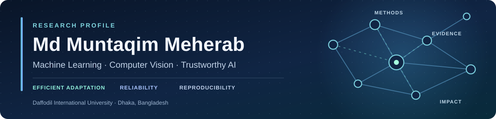
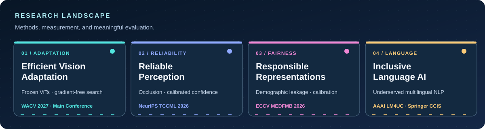

<div align="center">



<br />

[](https://meherabb.github.io/)
[](https://github.com/meherabb?tab=repositories)
[](mailto:meherab2305101354@diu.edu.bd)

<br />

**Machine Learning Researcher · Research Assistant, NLP & ML Research Lab**  
**B.Sc. in Computer Science & Engineering · Daffodil International University, Bangladesh**

*Building efficient, reliable, and accessible machine learning systems—with an emphasis on empirical rigor and reproducibility.*

</div>

---

### Research in one sentence

My research examines **where learned representations succeed, where they fail, and how to make their adaptation and evaluation more reliable**—especially in computer vision, remote sensing, medical imaging, multilingual NLP, and compute-constrained settings.

I work across **representation learning, parameter-efficient adaptation, reliability and calibration, fairness, and compute-aware evaluation**. I aim to connect methodological contributions to carefully designed experiments, transparent limitations, and usable research artifacts.

### Research landscape



<table>
<tr>
<td width="50%" valign="top">

**01 · Efficient adaptation**

Task-aware use of intermediate features in pretrained vision transformers, frozen-backbone adaptation, and gradient-free architecture exploration.

</td>
<td width="50%" valign="top">

**02 · Reliability under shift**

Model confidence, calibration, uncertainty, and failures under occlusion or changing real-world conditions.

</td>
</tr>
<tr>
<td valign="top">

**03 · Responsible representations**

Demographic information encoded in medical foundation models and its implications for downstream fairness.

</td>
<td valign="top">

**04 · Equitable machine learning**

Compute inequality, evaluation under explicit resource budgets, and multilingual accessibility.

</td>
</tr>
</table>

---

### Selected research

A selection of accepted research outputs. **Conference main tracks, position-paper tracks, and workshops are distinguished explicitly.** For my broader research portfolio, see the [academic website](https://meherabb.github.io/).

| Year | Research | Venue / distinction | Research artifact |
|:---:|---|---|---|
| **2027** | **Zero-Gradient Mid-layer Evolutionary Homophilic Exploration for Remote-sensing Adaptation with Frozen Backbones** | **IEEE/CVF WACV 2027**, Applications Track (main conference) | [MEHERAB code](https://github.com/meherabb/meherab) |
| **2026** | **Position: The Machine Learning Community Must Treat Compute Inequality as a First-Class Research Problem** | **ICML 2026**, Position Paper Track — **Spotlight** | [Research portfolio](https://meherabb.github.io/) |
| **2026** | **Does Confidence Track Visibility? Diagnosing Blind Confidence in Cloud-Occluded Flood Segmentation** | **NeurIPS 2026**, Tackling Climate Change with Machine Learning (TCCML) Workshop | [Code & experiments](https://github.com/meherabb/blind-confidence-flood-mapping) |
| **2026** | **What Your CXR Reveals Beyond the Pathology: Causal Evidence for Demographic Leakage in Medical Foundation Model Embeddings and Its Calibration Fairness Consequences** | **ECCV 2026**, Medical Foundation Models and Benchmarks Workshop | [Code & experiments](https://github.com/meherabb/demographic-leakage-cxr) |
| **2026** | **TRIM: Token-budgeted Data Mining for Instruction Tuning** | **ICLR 2026**, DATA-FM Workshop | [Research portfolio](https://meherabb.github.io/) |
| **2026** | **Advancing NLP Equity: A Secondary Benchmark Evaluation of Multilingual Language Models for Underrepresented Languages** | **AAAI 2026 LM4UC Workshop**; accepted Springer CCIS chapter (forthcoming) | [Paper](https://openreview.net/forum?id=YlTVWukmJe) |
| **2025** | **CoSSA: Correlation-Structure Shift Adapter for Cross-City Urban Forecasting** | **NeurIPS 2025**, UrbanAI Workshop | [Paper](https://openreview.net/pdf?id=596OsHKOpf) |

<sub>Venue labels indicate the specific track or workshop rather than implying acceptance to the corresponding conference's main technical track. Publication records and links are updated as proceedings become available.</sub>

---

### Featured open research

<table>
<tr>
<td width="50%" valign="top">

#### [MEHERAB](https://github.com/meherabb/meherab)

**Frozen-backbone remote-sensing adaptation**  
**WACV 2027 · Applications Track**

Explores discriminative mid-layer structure in vision transformers and searches for lightweight feature pathways without updating backbone weights.

**Methods:** ViTs · CKA · Fisher Discriminant Ratio · evolutionary search

[Explore implementation](https://github.com/meherabb/meherab) · [Reproduction guide](https://github.com/meherabb/meherab/blob/main/docs/REPRODUCING.md)

</td>
<td width="50%" valign="top">

#### [Blind Confidence in Flood Mapping](https://github.com/meherabb/blind-confidence-flood-mapping)

**Calibration under cloud occlusion**  
**NeurIPS 2026 · TCCML Workshop**

Investigates whether confidence reflects the loss of visual evidence in flood segmentation, using optical, SAR, and fusion baselines.

**Methods:** Multimodal remote sensing · calibration · selective prediction

[Explore implementation](https://github.com/meherabb/blind-confidence-flood-mapping)

</td>
</tr>
<tr>
<td width="50%" valign="top">

#### [Demographic Leakage in CXR Embeddings](https://github.com/meherabb/demographic-leakage-cxr)

**Medical foundation-model reliability**  
**ECCV 2026 · MEDFMB Workshop**

Studies the demographic information retained in frozen chest X-ray representations and its relationship to downstream calibration disparities.

**Methods:** Foundation models · leakage probes · nullspace interventions

[Explore implementation](https://github.com/meherabb/demographic-leakage-cxr)

</td>
<td width="50%" valign="top">

#### [Research Portfolio & Publications](https://meherabb.github.io/)

**Research, writing, and reproducibility**

A central index of research themes, selected papers, academic background, and contact information.

**Areas:** Vision · NLP · generative AI · trustworthy ML

[Visit academic website](https://meherabb.github.io/) · [Browse repositories](https://github.com/meherabb?tab=repositories)

</td>
</tr>
</table>

---

### From question to reproducible evidence

```text
Research question
      │
      ▼
Hypothesis & failure mode
      │
      ▼
Strong baselines ──► Controlled interventions ──► Ablations
      │                                              │
      └──────────────► Statistical evaluation ◄───────┘
                              │
                              ▼
                Limitations & reproducibility
                              │
                              ▼
                    Public research artifact
```

**My research principles:** formulate falsifiable questions; benchmark against meaningful alternatives; report negative results; isolate confounders; make compute costs and reproducibility requirements explicit.

### Technical toolkit

<div align="center">


</div>

**Core methods:** deep learning · representation learning · vision transformers · parameter-efficient fine-tuning · uncertainty quantification · statistical testing · experimental design

---

### Academic background & research service

- **Research Assistant**, NLP & ML Research Lab, Daffodil International University.
- **B.Sc. in Computer Science & Engineering**, Daffodil International University (in progress).
- **Research reviewing and service** spanning ML conferences and workshops, including NeurIPS position papers and ICLR workshop venues.
- **Research interests** that bridge methodological ML, practical constraints, and responsible deployment.

### Connect

For **research collaboration, methodological discussion, and reproducibility questions**:

<div align="center">

**[Academic website](https://meherabb.github.io/)** · **[Email](mailto:meherab2305101354@diu.edu.bd)** · **[GitHub repositories](https://github.com/meherabb?tab=repositories)**

<sub>Research first. Evidence always. Open to thoughtful collaborations.</sub>

</div>
